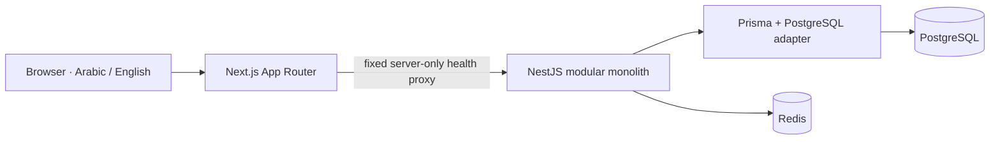

# Architecture

## Boundary and deployment model

VENTRO is a pnpm modular monolith: one Next.js web application and one NestJS API backed by PostgreSQL and Redis. There are no business modules in Phase 1. Socket.IO and BullMQ belong to later approved real-time and background-job milestones; their services and packages are deliberately not initialized yet.

## Shared packages and build order

- `@ventro/config`: strict compiler options, flat ESLint config, Prettier. Configuration has no application runtime responsibility.
- `@ventro/types`: compiled CommonJS contracts with declarations and Zod runtime health validation. Build this before consumers.
- `@ventro/ui`: source-distributed React components, shadcn-compatible Button, centralized brand tokens. Next.js transpiles this package.
- API: Prisma generation precedes compilation; Nest's TypeScript compiler emits decorator metadata. Tests import compiled Nest modules to exercise the same dependency metadata as production.
- Web: standard Next.js App Router build; health requests happen at runtime, never as a build-time dependency.

Node 24 and pnpm 10 are fixed workspace requirements. Prisma 7 uses `prisma.config.ts`, a generated `prisma-client`, and `@prisma/adapter-pg`. Versions and all transitive dependencies are captured by the lockfile.

## API infrastructure

`/api` is the global prefix. URI versioning defaults to `v1`, giving future domain APIs `/api/v1/...`. Operational readiness and liveness are deliberately version neutral:

| Endpoint                | Meaning                                             |
| ----------------------- | --------------------------------------------------- |
| `GET /api/health`       | Actual PostgreSQL SELECT and Redis PING; 200 or 503 |
| `GET /api/health/live`  | HTTP process is alive; 200                          |
| `GET /api/openapi.json` | OpenAPI document when enabled                       |
| `GET /api/docs`         | Swagger UI when enabled                             |

Dependency checks run concurrently with bounded database/Redis connection and query timeouts. Neither database nor Redis failure blocks HTTP startup, so readiness can explain degraded state. Shutdown disconnects both clients. No connection string or dependency error is returned by health endpoints.

Global validation transforms explicit DTOs, rejects unknown fields and unknown objects, disables implicit primitive coercion, and omits submitted values from validation errors. A global exception filter returns statusCode, error, safe message, timestamp, path, and requestId. Unhandled errors are logged and return a generic 500 message.

Pino emits structured JSON, generates UUID request IDs, sets `X-Request-Id`, strips query strings from access-log URLs, and redacts authorization/cookie headers. Request bodies are not logged. Logs must be treated as operationally sensitive and access-controlled in deployment.

Helmet sets backend security headers. Exact CORS origins come from validated environment configuration, with no credential sharing. Non-browser requests without Origin remain supported. Origin checks do not replace future authentication.

## Frontend behavior

Phase 2 extends `@ventro/ui` into the shared brand and interface library. Original mark/wordmark geometry drives both the React `BrandLogo` and generated SVG exports. Semantic tokens support both themes; locally bundled Fontsource files provide Plus Jakarta Sans, Inter, and IBM Plex Sans Arabic. No font CDN or image generation service is used.

The global `LocaleProvider` owns document language/direction, local preference persistence, Radix direction context, and localized notification labels. Existing health-page behavior uses this shared locale. Next-themes continues to own themes; MotionConfig applies the reduced-motion policy. Radix primitives provide the interaction behavior for selection, dialogs, menus, tabs, tooltips, and toasts. See DESIGN_SYSTEM.md for consumer responsibilities, including accessible names and form validation boundaries.

`/dev/design-system` dynamically imports the showcase only after a development-environment guard. A narrow Next.js Proxy matcher rejects this path before rendering outside development, ensuring a real 404 even when the app has a streaming loading boundary. Its controls demonstrate local UI state and perform no business API mutations. Playwright/axe checks run in a dedicated CI job; production smoke checks enforce the route guard. No API endpoints, database models, or authorization behavior are introduced in Phase 2.

The server-only `API_INTERNAL_URL` targets the backend. A fixed `/api/health` route validates both payload shape and HTTP status and prevents caching. Browser code only requests the same-origin path. It supports loading, ready, degraded, empty, and error states with retry; no status or business statistic is fabricated.

Public locale URLs are `/en` and `/ar`, with eight corresponding subpages. The allowlisted optional catch-all route keeps routing and SEO generation shared while rejecting unknown public slugs. A Next.js Proxy redirects `/` and injects a locale header derived from the URL, overwriting inbound values. The root layout reads that header to render the correct HTML language/direction before hydration. This intentionally uses dynamic SSR (`headers()`); it preserves the existing root providers/development routes and avoids duplicated HTML layouts or a new localization dependency. Theme remains a device preference; the public URL is authoritative for language. Server components render the public narrative; small client components own menus, previews, filters, local contact-brief preparation, and FAQ search. No business data is fetched or fabricated.

The original health page now lives at `/dev/foundation`. Both `/dev/*` routes are rejected before streaming in production. The same-origin health proxy and all backend behavior are preserved.

Shared logical spacing supports RTL. Motion reveals move content without fading text below its contrast target; decorative entrance animations finish within four seconds, and parallax/interaction motion respects reduced-motion preferences. Below-fold reveals use Motion's IntersectionObserver utility and mini Web Animations implementation, avoiding a full React animation component for every section. The hero uses LazyMotion's smaller DOM feature set; preview transitions run only when a user changes tabs. All narrative content remains visible in server HTML before animation code runs. Local WebP photographs use Next.js responsive Image optimization; the hero uses eager loading, high fetch priority, and quality 75 without a JavaScript-dependent blur removal. Source/license records live in ASSET_LICENSES.md and the media manifest. No runtime font/photo CDN is required.

`SITE_URL` validates the canonical origin. Local/staging defaults are noindex; explicit indexing also requires HTTPS. Metadata includes canonical URLs, EN/AR/x-default alternatives, Open Graph/Twitter metadata, an original `/og` PNG composition, robots, and an eighteen-page sitemap. Pricing remains proposed/TBA. Contact data stays in memory and is copied only by user action; an optional configured email enables a mail-client draft, never a false delivery confirmation. Legal documents describe preview behavior and remain drafts until the operator and launch terms are approved. No contact tables, email service, public registration, or marketing analytics are added.

## Data, isolation, and authorization

There are no domain models, seed business records, tenants, or user accounts in Phase 1. All exposed endpoints are public operational checks containing no tenant data. No repository or domain data endpoint can be added without server-side authorization and tenant ownership.

Before domain development, approve tenant/user relationships and access rules; scope every business query and mutation by authenticated tenant context; test cross-tenant access. A client-supplied tenant ID alone must never determine access. Row-level security may be defense in depth, but is not assumed or claimed here.

## Infrastructure and environment

Docker Compose defines PostgreSQL 17 and Redis 7.4, authenticated Redis, persistent named volumes, health checks, loopback host bindings, and non-escalating containers. Root `.env` supplies development credentials. Application startup validates protocols, ports, allowed origins, and production HTTPS origins.

The foundation does not include production hosting, backups, secret rotation, authorization, queues, websocket events, or deployment automation. These must be designed as their corresponding phases are approved.
