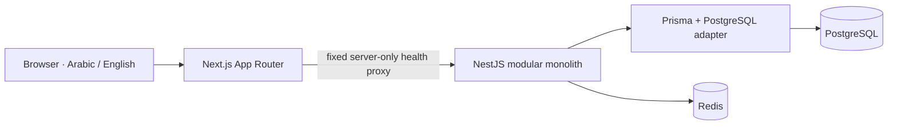

# Architecture

## Optional organizer AI

AiModule exposes tenant-scoped GET/POST organizations/:id/ai. AiProvider isolates
the concrete Anthropic Messages HTTP adapter. Environment defaults to disabled,
with secrets confined to the API. Generation checks live events:write permission,
explicit non-personal-input authorization and a Redis atomic daily counter before
network I/O. No participant query, event mutation, tool execution or output HTML is
part of this boundary. The UI requires manual review before copying a draft.
See [AI_ASSISTANT.md](AI_ASSISTANT.md) for configuration, privacy and verification.

## Boundary and deployment model

VENTRO is a pnpm modular monolith: one Next.js web application and one NestJS API backed by PostgreSQL and Redis. There are no business modules in Phase 1. Socket.IO and BullMQ belong to later approved real-time and background-job milestones; their services and packages are deliberately not initialized yet.

Event management is an organization-scoped module in the same NestJS process. Prisma owns `Event`, `EventCategory`, `EventSpeaker`, `EventSession`, and bounded `EventMedia` persistence; public reads are deliberately separated from authenticated organizer commands. See [EVENTS](EVENTS.md).

Registration forms and submissions are an adjacent transactional module. Capacity is guarded with PostgreSQL row locking and a unique attendee/event constraint, not browser counters. See [REGISTRATIONS](REGISTRATIONS.md).

## Shared packages and build order

- `@ventro/config`: strict compiler options, flat ESLint config, Prettier. Configuration has no application runtime responsibility.
- `@ventro/types`: compiled CommonJS contracts with declarations and Zod runtime health validation. Build this before consumers.
- `@ventro/ui`: source-distributed React components, shadcn-compatible Button, centralized brand tokens. Next.js transpiles this package.
- API: Prisma generation precedes compilation; Nest's TypeScript compiler emits decorator metadata. Tests import compiled Nest modules to exercise the same dependency metadata as production.
- Web: standard Next.js App Router build; health requests happen at runtime, never as a build-time dependency.

Node 24 and pnpm 10 are fixed workspace requirements. Prisma 7 uses `prisma.config.ts`, a generated `prisma-client`, and `@prisma/adapter-pg`. Versions and all transitive dependencies are captured by the lockfile.

## API infrastructure

`/api` is the global prefix. URI versioning defaults to `v1`, giving future domain APIs `/api/v1/...`. Operational readiness and liveness are deliberately version neutral:

| Endpoint                | Meaning                                             |
| ----------------------- | --------------------------------------------------- |
| `GET /api/health`       | Actual PostgreSQL SELECT and Redis PING; 200 or 503 |
| `GET /api/health/live`  | HTTP process is alive; 200                          |
| `GET /api/openapi.json` | OpenAPI document when enabled                       |
| `GET /api/docs`         | Swagger UI when enabled                             |

Dependency checks run concurrently with bounded database/Redis connection and query timeouts. Neither database nor Redis failure blocks HTTP startup, so readiness can explain degraded state. Shutdown disconnects both clients. No connection string or dependency error is returned by health endpoints.

Global validation transforms explicit DTOs, rejects unknown fields and unknown objects, disables implicit primitive coercion, and omits submitted values from validation errors. A global exception filter returns statusCode, error, safe message, timestamp, path, and requestId. Unhandled errors are logged and return a generic 500 message.

Pino emits structured JSON, generates UUID request IDs, sets `X-Request-Id`, strips query strings from access-log URLs, and redacts authorization/cookie headers. Request bodies are not logged. Logs must be treated as operationally sensitive and access-controlled in deployment.

Helmet sets backend security headers. Exact CORS origins come from validated environment configuration, with no credential sharing. Non-browser requests without Origin remain supported. Origin checks do not replace future authentication.

## Frontend behavior

Phase 2 extends `@ventro/ui` into the shared brand and interface library. Original mark/wordmark geometry drives both the React `BrandLogo` and generated SVG exports. Semantic tokens support both themes; locally bundled Fontsource files provide Plus Jakarta Sans, Inter, and IBM Plex Sans Arabic. No font CDN or image generation service is used.

The global `LocaleProvider` owns document language/direction, local preference persistence, Radix direction context, and localized notification labels. Existing health-page behavior uses this shared locale. Next-themes continues to own themes; MotionConfig applies the reduced-motion policy. Radix primitives provide the interaction behavior for selection, dialogs, menus, tabs, tooltips, and toasts. See DESIGN_SYSTEM.md for consumer responsibilities, including accessible names and form validation boundaries.

`/dev/design-system` dynamically imports the showcase only after a development-environment guard. A narrow Next.js Proxy matcher rejects this path before rendering outside development, ensuring a real 404 even when the app has a streaming loading boundary. Its controls demonstrate local UI state and perform no business API mutations. Playwright/axe checks run in a dedicated CI job; production smoke checks enforce the route guard. No API endpoints, database models, or authorization behavior are introduced in Phase 2.

The server-only `API_INTERNAL_URL` targets the backend. A fixed `/api/health` route validates both payload shape and HTTP status and prevents caching. Browser code only requests the same-origin path. It supports loading, ready, degraded, empty, and error states with retry; no status or business statistic is fabricated.

Public locale URLs are `/en` and `/ar`, with eight corresponding subpages. The allowlisted optional catch-all route keeps routing and SEO generation shared while rejecting unknown public slugs. A Next.js Proxy redirects `/` and injects a locale header derived from the URL, overwriting inbound values. The root layout reads that header to render the correct HTML language/direction before hydration. This intentionally uses dynamic SSR (`headers()`); it preserves the existing root providers/development routes and avoids duplicated HTML layouts or a new localization dependency. Theme remains a device preference; the public URL is authoritative for language. Server components render the public narrative; small client components own menus, previews, filters, local contact-brief preparation, and FAQ search. No business data is fetched or fabricated.

The original health page now lives at `/dev/foundation`. Both `/dev/*` routes are rejected before streaming in production. The same-origin health proxy and all backend behavior are preserved.

Shared logical spacing supports RTL. Motion reveals move content without fading text below its contrast target; decorative entrance animations finish within four seconds, and parallax/interaction motion respects reduced-motion preferences. Below-fold reveals use Motion's IntersectionObserver utility and mini Web Animations implementation, avoiding a full React animation component for every section. The hero uses LazyMotion's smaller DOM feature set; preview transitions run only when a user changes tabs. All narrative content remains visible in server HTML before animation code runs. Local WebP photographs use Next.js responsive Image optimization; the hero uses eager loading, high fetch priority, and quality 75 without a JavaScript-dependent blur removal. Source/license records live in ASSET_LICENSES.md and the media manifest. No runtime font/photo CDN is required.

`SITE_URL` validates the canonical origin. Local/staging defaults are noindex; explicit indexing also requires HTTPS. Metadata includes canonical URLs, EN/AR/x-default alternatives, Open Graph/Twitter metadata, an original `/og` PNG composition, robots, and an eighteen-page sitemap. Pricing remains proposed/TBA. Contact data stays in memory and is copied only by user action; an optional configured email enables a mail-client draft, never a false delivery confirmation. Legal documents describe preview behavior and remain drafts until the operator and launch terms are approved. No contact tables, email service, public registration, or marketing analytics are added.

## Data, isolation, and authorization

Phase 4 adds the authentication database foundation and versioned auth module. Users own opaque, hashed sessions and verification/reset tokens. The development seed creates only an explicitly labeled local account/organization/member/audit fixture. Phase 5 exposes organization management through a dedicated Organizations module; event logic remains absent.

Next.js uses an allowlisted same-origin authentication proxy. Browser forms never read the HTTP-only cookie. Protected account pages are checked before streaming and again server-side; the NestJS guards remain the authority for profile/session data. Passwords use Argon2id, tokens use random 256-bit values stored as hashes, and credential-version/user-row locking protects reset/login/renew races. JSON/origin/custom-header validation, Redis limits, and safe logging apply at the auth boundary.

`EmailOutbox` stores encrypted delivery intent transactionally with user/token changes. A leased PostgreSQL worker in the API delivers real SMTP email, retries outages, and clears payload content after handoff. A confirmed event registration creates its ticket in the same transaction. A verified VENTRO account gains a preference-aware outbox entry and persistent in-app notification; a guest has no user row or cookie but receives a durable outbox email directly. Both localized emails embed an opaque-ticket QR image and never encode participant data in that image. Redis is used for distributed rate counters; a new queue service is not needed for these modest authentication and registration deliveries. Mailpit is the requested development email testing service. Prisma sessions explicitly use UTC to keep adapter dates, SQL clocks, leases, and expirations consistent across host timezones. See [AUTHENTICATION](AUTHENTICATION.md) for the exact security policy, contracts, retention, deployment constraints, and tests.

Before domain development, approve tenant/user relationships and access rules; scope every business query and mutation by authenticated tenant context; test cross-tenant access. A client-supplied tenant ID alone must never determine access. Row-level security may be defense in depth, but is not assumed or claimed here.

### Organization boundary (Phase 5)

`OrganizationMember` now carries OWNER, EVENT_MANAGER, CHECK_IN_STAFF or PARTICIPANT. An orthogonal USER/PLATFORM_ADMIN account permission supports a limited global directory; it never bypasses tenant membership or grants team administration. Shared permission constants drive service checks and role-based navigation. Profile/team/logo/invitation endpoints validate the current session and verification state, then membership/permission within authorized transactions. A user lock followed by an organization lock serializes membership mutations, invitation consumption and last-active-owner checks. Organization IDs are selectors, never authorization claims.

`Session.activeOrganizationId` is a persistent per-session preference. Switching checks membership; removing a member clears it across their sessions. Other memberships and sessions remain valid. Every explicit organization request still requires its own authorization, so tabs and manipulated IDs cannot borrow access from the preference.

`OrganizationInvitation` binds normalized recipient email, organization, membership role, issuer, hashed token, expiry and response state. Verified recipients may review/respond to their own invitation without existing membership. The issuer must still be an active owner. Seven-day single-use invitations use the existing encrypted transactional SMTP outbox, now supporting recipients without accounts. Reissuing rotates tokens; removing/demoting issuers revokes pending invitations. Sensitive operations write organization-scoped audit records in the same transaction.

`OrganizationLogo` stores bounded sanitized PNG bytes separately from profile queries. Sharp accepts only validated static PNG/JPEG/WebP, enforces byte/pixel/output bounds and removes source metadata. Private image requests require current membership and bypass Next's public optimizer cache. This avoids adding object storage before scale requires it. All lists paginate; documented organization/member/invitation caps bound initial storage and administration operations.

The localized workspace adds organization creation/settings, team roles/removal, actual invitation email/accept/reject, switching and a limited platform directory. Same-origin proxies validate allowlisted methods/paths and response contracts, preserve CSRF checks for JSON and multipart, and never publicly cache tenant data. Protected page access is checked before streaming and again in server components; API authorization remains authoritative. See [ORGANIZATIONS](ORGANIZATIONS.md) for the matrix, endpoints, limits, migration and security tests.

## Infrastructure and environment

Docker Compose defines PostgreSQL 17, authenticated Redis 7.4, and local SMTP/Mailpit, with persistent named volumes, health checks, loopback host bindings, and non-escalating containers. Root `.env` supplies development credentials. Application startup validates protocols, ports, allowed origins, and production HTTPS origins.

## Live engagement (Phase 10)

`EngagementModule` is a modular-monolith feature, not a separate realtime service. Its REST controller and Socket.IO `/engagement` namespace use the existing session cookie, verified-email guard, origin policy, audit service, Prisma connection, and organization authorization. A WebSocket handshake requires both an allowed `WEB_ORIGINS` origin and a valid session. Joining `event:<id>` then independently checks organization membership or confirmed registration; client event IDs never grant access by themselves.

Poll transitions and writes are database-backed. Vote handling locks the poll row in a Prisma transaction, rechecks LIVE state, then writes through the `PollVote` uniqueness constraint before broadcasting the fresh aggregate. Q&A uses equivalent room checks and unique question-vote constraints. Web presentation uses same-origin allowlisted REST relays for initial data and Socket.IO only for deltas; neither browser client holds a credential token.

The foundation does not include production hosting, backups, managed secret rotation, or deployment automation. These must be designed as their corresponding phases are approved.

## Quality and production-operational boundary (Phases 15–16)

Phase 15 verifies the local application artifact with strict compiler, lint, unit, integration, browser, accessibility, build, and Lighthouse checks. It does not turn local services into a production environment. The observed results and release blockers are in [QA_REPORT.md](QA_REPORT.md).

Phase 16 defines a provider-neutral target: Next.js hosting, a NestJS service, managed PostgreSQL/Redis, private object storage, transactional email, HTTPS ingress, managed secrets, structured logs, error monitoring, verified backups, and rehearsed recovery. Migrations run once as a controlled release job; they are not run from every replica. PostgreSQL remains the source of truth, while Redis supports queues/rate limits and must not be treated as the sole record of business state.

No deployment, production domain, real payment, production email provider, monitoring service, or backup system is configured by this repository. See [DEPLOYMENT_GUIDE.md](DEPLOYMENT_GUIDE.md) and [OPERATIONS_RUNBOOK.md](OPERATIONS_RUNBOOK.md) before making infrastructure changes.

## Certificates and Event Passport (Phase 11)

Certificates are immutable snapshots of the recipient name, event title, eligibility outcome, template, learning hours, issue date, and UUID verification ID. The public verifier returns only the verification result and display-safe certificate facts; PDF bytes and Passport settings remain private. Revocation changes the certificate state server-side and makes verification invalid immediately.

BullMQ uses the existing authenticated Redis instance. The API owns a narrowly scoped `certificate-generation` queue/worker with deterministic job IDs, bounded retries and exponential backoff. PostgreSQL remains the source of truth: a job only renders a pending certificate, persists PDF bytes, and records `GENERATED` or `FAILED`. There is no client-controlled PDF content or background-job authorization path.

Passport reads derive completed events, attendance, certificates, and learning hours from real registrations/check-ins/certificates. The owner always has a private view. A public slug only resolves when `profileVisible` is enabled; each additional field group has its own visibility setting, preventing email, internal attendance, or unshared achievements from leaking.
