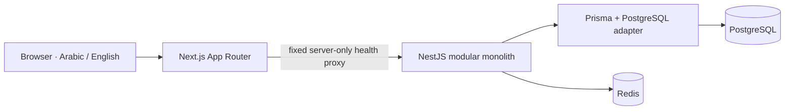

# Architecture

## Boundary and deployment model

VENTRO is a pnpm modular monolith: one Next.js web application and one NestJS API backed by PostgreSQL and Redis. There are no business modules in Phase 1. Socket.IO and BullMQ belong to later approved real-time and background-job milestones; their services and packages are deliberately not initialized yet.

## Shared packages and build order

- `@ventro/config`: strict compiler options, flat ESLint config, Prettier. Configuration has no application runtime responsibility.
- `@ventro/types`: compiled CommonJS contracts with declarations and Zod runtime health validation. Build this before consumers.
- `@ventro/ui`: source-distributed React components, shadcn-compatible Button, centralized brand tokens. Next.js transpiles this package.
- API: Prisma generation precedes compilation; Nest's TypeScript compiler emits decorator metadata. Tests import compiled Nest modules to exercise the same dependency metadata as production.
- Web: standard Next.js App Router build; health requests happen at runtime, never as a build-time dependency.

Node 24 and pnpm 10 are fixed workspace requirements. Prisma 7 uses `prisma.config.ts`, a generated `prisma-client`, and `@prisma/adapter-pg`. Versions and all transitive dependencies are captured by the lockfile.

## API infrastructure

`/api` is the global prefix. URI versioning defaults to `v1`, giving future domain APIs `/api/v1/...`. Operational readiness and liveness are deliberately version neutral:

| Endpoint                | Meaning                                             |
| ----------------------- | --------------------------------------------------- |
| `GET /api/health`       | Actual PostgreSQL SELECT and Redis PING; 200 or 503 |
| `GET /api/health/live`  | HTTP process is alive; 200                          |
| `GET /api/openapi.json` | OpenAPI document when enabled                       |
| `GET /api/docs`         | Swagger UI when enabled                             |

Dependency checks run concurrently with bounded database/Redis connection and query timeouts. Neither database nor Redis failure blocks HTTP startup, so readiness can explain degraded state. Shutdown disconnects both clients. No connection string or dependency error is returned by health endpoints.

Global validation transforms explicit DTOs, rejects unknown fields and unknown objects, disables implicit primitive coercion, and omits submitted values from validation errors. A global exception filter returns statusCode, error, safe message, timestamp, path, and requestId. Unhandled errors are logged and return a generic 500 message.

Pino emits structured JSON, generates UUID request IDs, sets `X-Request-Id`, strips query strings from access-log URLs, and redacts authorization/cookie headers. Request bodies are not logged. Logs must be treated as operationally sensitive and access-controlled in deployment.

Helmet sets backend security headers. Exact CORS origins come from validated environment configuration, with no credential sharing. Non-browser requests without Origin remain supported. Origin checks do not replace future authentication.

## Frontend behavior

The server-only `API_INTERNAL_URL` targets the backend. A fixed `/api/health` route validates both payload shape and HTTP status and prevents caching. Browser code only requests the same-origin path. It supports loading, ready, degraded, empty, and error states with retry; no status or business statistic is fabricated.

Locale preference controls document language and direction, persists locally when available, and supplies English/Arabic messages. Shared logical spacing supports RTL. Theme uses CSS variables with system/light/dark support. Motion respects reduced-motion preferences. Full domain localization, translation review, and locale URLs remain later concerns.

## Data, isolation, and authorization

There are no domain models, seed business records, tenants, or user accounts in Phase 1. All exposed endpoints are public operational checks containing no tenant data. No repository or domain data endpoint can be added without server-side authorization and tenant ownership.

Before domain development, approve tenant/user relationships and access rules; scope every business query and mutation by authenticated tenant context; test cross-tenant access. A client-supplied tenant ID alone must never determine access. Row-level security may be defense in depth, but is not assumed or claimed here.

## Infrastructure and environment

Docker Compose defines PostgreSQL 17 and Redis 7.4, authenticated Redis, persistent named volumes, health checks, loopback host bindings, and non-escalating containers. Root `.env` supplies development credentials. Application startup validates protocols, ports, allowed origins, and production HTTPS origins.

The foundation does not include production hosting, backups, secret rotation, authorization, queues, websocket events, or deployment automation. These must be designed as their corresponding phases are approved.
